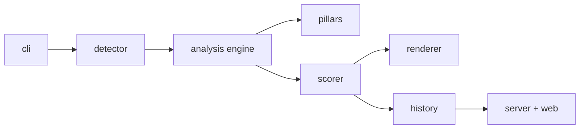

# Architecture

How a scan flows through the code. What the checks are and how levels are scored is in `README.md`.

## Flow of one scan

1. **CLI** (`src/cli/`) parses the options, reads `.agent-readiness.yml` (`src/engine/config.ts`) and picks the profile.
2. **Detector** (`src/engine/detector.ts`) finds the project types (from manifests such as `package.json` or `go.mod`) and monorepo packages. With `--github`, `src/engine/github.ts` adds branch protection and security settings through `gh`.
3. **Analysis engine** (`src/engine/analyzer.ts`) runs every enabled criterion of every pillar. A criterion that does not apply (`src/pillars/applicability.ts`) gets N/A; one that needs an LLM is skipped without `--ai`.
4. **Pillars** (`src/pillars/`) hold the criteria, one file per pillar. `profiles.ts` adapts the set for `--profile internal`; `guardrails.ts` holds the checks about rules agents must follow.
5. **Scorer** (`src/engine/scorer.ts`) turns the results into a score per pillar and a maturity level; N/A and skipped checks do not count.
6. **Recommender** (`src/engine/recommender.ts`) turns failed checks into fixes, ordered by level and impact.
7. **Renderer** (`src/renderer/`) prints the terminal report, Markdown, or JSON (`src/engine/serializer.ts`).

## History and the dashboard

- With `--history <dir>`, `src/engine/history.ts` stores each scan as a snapshot in `<dir>/<repo>/` and compares it with the previous one. `org` summarizes the latest snapshot per repository.
- `src/server/` serves the dashboard and its JSON API on 127.0.0.1. With `--github-org`, `scanner.ts` lists the organization's repositories, shallow-clones the selected ones into a cache directory and scans them with this CLI into the same history.
- `web/` is the React + Vite dashboard. It is built into `dist/web` and served by the server; it only reads the API.

## AI checks

`src/engine/llm-client.ts` sends a criterion's question plus the relevant files either to an OpenAI-compatible API or to the local Claude Code CLI (`--ai-provider claude`).
