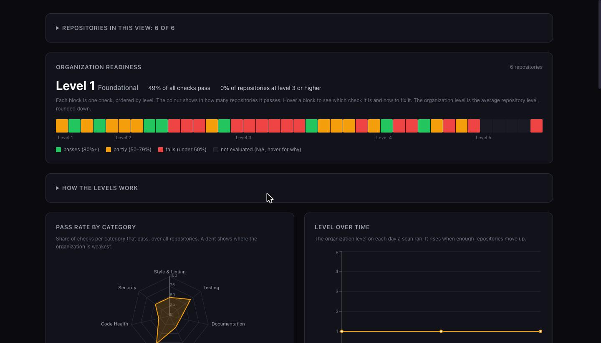
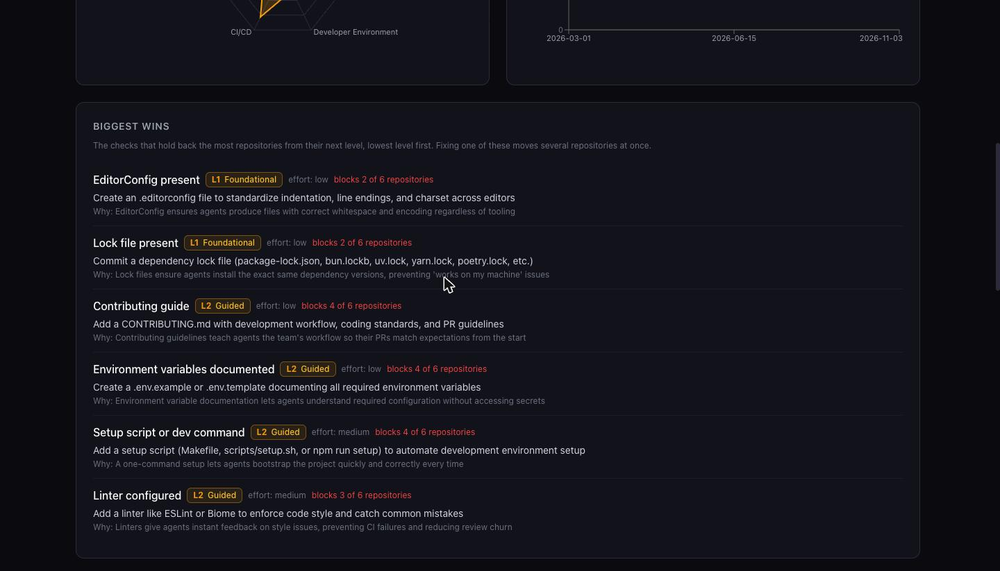
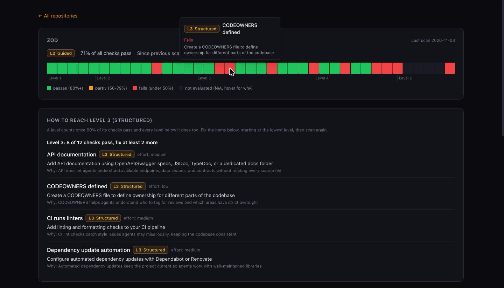

<p align="center">
  
</p>

<h1 align="center">Agent Readiness</h1>

<p align="center">
  <strong>See how ready every repository is for AI coding agents, and exactly what to fix next.</strong>
</p>

<p align="center">
  <a href="LICENSE"></a>
  
  
  
  
</p>

<p align="center">
  
</p>

Claude Code, Cursor, Copilot and Codex do their best work in repositories that tell them how to build, test, lint and ship. **Agent Readiness** scans your repositories for exactly that, scores each one on five maturity levels, and turns the gaps into a to-do list, for one repository or a whole GitHub organization.

Everything runs on your machine. No code leaves it, no account, no subscription.

---

## Highlights

| | |
|---|---|
| **One repository or a whole org** | Scan a single repo, or follow every repository in your GitHub organization from one dashboard. |
| **A to-do list, not just a score** | "Biggest wins" shows which checks hold back the most repositories, with the fix and why it matters to an agent. |
| **A plan per repository** | Open any repository to see what it needs for its next level, starting at the lowest. |
| **History and trends** | Every scan is a snapshot. See the organization level over time and what changed since the last scan. |
| **Fair to every kind of repo** | Docs, infra and GitOps repositories get N/A for code-only checks, monorepos are searched per service, and the reason shows on hover. |
| **Reads GitHub itself** | With `--github`, branch protection, secret scanning, push protection and Dependabot come from the real GitHub settings. |
| **AI checks without an API key** | The five AI checks can run through your local Claude Code login. |
| **Built for company repos** | `--profile internal` drops open-source-only checks such as LICENSE and SECURITY.md. |
| **CI gate** | `--ci --min-level 3` fails a build that drops below the level you want. |

---

## See it in action

<table>
  <tr>
    <td width="50%"></td>
    <td width="50%"></td>
  </tr>
  <tr>
    <td><strong>Biggest wins.</strong> The checks that hold back the most repositories, lowest level first, with the fix and the reason.</td>
    <td><strong>A plan per repository.</strong> Hover any block for the check and its fix; below it, what to do to reach the next level.</td>
  </tr>
</table>

---

## Quick start

Agent Readiness runs on [Bun](https://bun.sh) and is not on npm yet, so install it from source:

```bash
git clone https://github.com/Innovature-nl/agent-readiness.git
cd agent-readiness
bun install
bun run build:all
npm link            # puts the agent-readiness command on your PATH
```

Then scan a repository:

```bash
agent-readiness /path/to/repo                       # report in the terminal plus a web dashboard
agent-readiness /path/to/repo --github              # also read the GitHub settings (uses gh)
agent-readiness /path/to/repo --ai --ai-provider claude   # add the AI checks through Claude Code
agent-readiness /path/to/repo --format json         # for scripts and integrations
agent-readiness /path/to/repo --format markdown > report.md   # to share or keep
```

---

## Your whole organization in one dashboard

The fastest way: let the dashboard list your GitHub organization and scan from there.

```bash
agent-readiness org ./readiness-history --github-org your-org --profile internal --scan-ai
```

Open <http://localhost:4747>, search the organization's repositories, select the ones you want and choose **Scan selected**. The server makes a shallow clone in `~/.cache/agent-readiness/repos`, scans it with the GitHub settings (and the AI checks with `--scan-ai`), and the page updates as each repository finishes. **Rescan the N in view** brings the selection up to date.

Prefer scripting? Scan into a history directory and open the overview:

```bash
for repo in ~/code/*/; do
  agent-readiness "$repo" --no-web --profile internal --github --history ./readiness-history
done
agent-readiness org ./readiness-history --profile internal
```

What the dashboard gives you:

- **Organization level**: the average repository level, rounded down, plus the share of repositories at level 3 or higher.
- **A block per check**, ordered by level and coloured by how many repositories pass it. Hover for the name, result and fix.
- **Pass rate per category** and **level over time**.
- **Biggest wins**: the checks that block the most repositories from their next level.
- **Checks by category**: click one to see the fix and which repositories fail it.
- **Repository pages** at `/repo/<name>`, so a refresh or a shared link keeps you there.
- **A repository picker** to leave repositories out of every number; the choice is saved in your browser.

Refreshing the page picks up new scans and the server stays on the same port (`--port` to change it). It listens on 127.0.0.1 only, because scans run with your `gh` login.

---

## How scoring works

### Five levels

A repository reaches a level when **80% of that level's checks pass and every level below it is reached**. One missing basic keeps a repository at level 1, however good the rest is.

| Level | Name | What an agent gets |
|---|---|---|
| **1** | Foundational | A README, a lock file and consistent formatting to find its way. |
| **2** | Guided | A linter, formatter, tests that run with one command, CI, a setup command and documented environment variables, so it can check its own work. |
| **3** | Structured | Type checking, pre-commit hooks, CI that runs tests and linters, AGENTS.md or CLAUDE.md, CODEOWNERS and dependency updates, so mistakes are caught early. |
| **4** | Optimized | Coverage, end-to-end tests, a deploy pipeline, branch protection, security and secret scanning, architecture docs, so changes ship safely. |
| **5** | Autonomous | Bundle analysis plus AI-judged quality: naming, tests, README and how agent-friendly the docs are. |

### Seven pillars

| Pillar | What it covers |
|---|---|
| 🎨 **Style & Linting** | Linter, formatter, type checker, pre-commit hooks, editorconfig, lint suppressions, project-specific lint rules, naming conventions |
| 🧪 **Testing** | Test framework, test files, test script, coverage, end-to-end tests, runtime verification skill, property-based, fuzz or formal verification, test quality |
| 📚 **Documentation** | README, contributing guide, API docs, CODEOWNERS, AI context files, architecture docs, enforced agent rules |
| 🔧 **Dev Environment** | Lock file, containers, environment variables, setup command, pinned runtime versions |
| ⚙️ **CI/CD** | CI config, tests and linters in CI, automated build, deploy pipeline, branch protection |
| 💚 **Code Health** | Dependency freshness, dead code detection, workaround comments, comment density, bundle analysis |
| 🔒 **Security** | License, security scanning, secret detection, security policy, dependency updates |

### Fair to every repository

- **N/A instead of fail.** Code-only checks (lock file, linter, tests, setup command and more) are N/A in repositories without a project manifest, such as docs, infra and GitOps repositories. Bundle analysis is N/A without a frontend bundler. N/A checks do not count toward the level, and the dashboard shows why on hover.
- **Monorepos.** Environment docs, setup targets, API contracts, end-to-end tests, coverage, test frameworks and strict TypeScript are found per service or package, not only in the root.
- **Built-in tooling counts.** Go gets `go vet` and `go test`, Rust gets clippy and `cargo test`.
- **Profiles.** `--profile internal` is for company repositories: it skips `license` and `security-policy`, lets `contributing` pass on AGENTS.md or CLAUDE.md and `editorconfig` pass on a formatter. Use the same profile for scans and for `org`.

---

## GitHub settings

Some checks depend on settings that live in GitHub, not in the files. Add `--github` and the scan reads them with the [`gh` CLI](https://cli.github.com) (`gh auth login` first). The repository comes from the `origin` remote, or pass `--github owner/repo`.

| Check | Read from GitHub |
|---|---|
| `branch-protection` | Rulesets and branch protection on the default branch |
| `secrets-detection` | Secret scanning and push protection |
| `dep-update-automation` | Dependabot security updates |
| `security-scanning` | Code scanning default setup |

Without `--github` the scan only looks at files. If GitHub cannot be read, the scan warns and continues.

---

## AI checks

Five checks ask a language model to judge what a file check cannot:

| Check | What it judges |
|---|---|
| `naming-conventions` | Whether file and function names follow consistent patterns an agent can copy |
| `test-quality` | Whether tests are meaningful and cover the key behaviour |
| `readme-quality` | Whether the README explains purpose, setup, usage and contribution |
| `docs-agent-friendliness` | Whether the docs help an agent find its way in the codebase |
| `enforced-agent-rules` | Whether the hard rules in the agent instruction files are backed by a hook, lint rule, CI workflow or check script that exists in the repository, and which are not. It sends only the rule sentences ("never", "must", "always", "do not" and the like) of every AGENTS.md and CLAUDE.md, in parts of 80,000 characters, at most six, so a large monorepo takes several calls |

**With Claude Code (no API key):**

```bash
agent-readiness . --ai --ai-provider claude
```

This runs each check through the local `claude` CLI with your existing login. Every check is a single prompt without tools, settings, hooks or MCP servers, and takes about two minutes per repository in total; a monorepo with many agent instruction files takes longer, because `enforced-agent-rules` then runs in parts.

**With any OpenAI-compatible API:**

```bash
export AGENT_READINESS_API_KEY=sk-your-key
agent-readiness . --ai --api-base-url https://your-endpoint/v1 --model your-model
```

Without `--ai` these checks are skipped and do not count as failures.

---

## CI integration

Fail a build when a repository drops below the level you want:

```yaml
name: Agent Readiness

on: [push, pull_request]

jobs:
  readiness:
    runs-on: ubuntu-latest
    steps:
      - uses: actions/checkout@v4
      - uses: oven-sh/setup-bun@v2
      - name: Install Agent Readiness
        run: |
          git clone --depth 1 https://github.com/Innovature-nl/agent-readiness.git /tmp/agent-readiness
          cd /tmp/agent-readiness && bun install && bun run build
      - name: Check agent readiness
        run: node /tmp/agent-readiness/dist/index.js . --ci --min-level 3
```

| Exit code | Meaning |
|---|---|
| `0` | The level meets or exceeds `--min-level` |
| `1` | The level is below `--min-level` |

---

## Configuration

`agent-readiness --init` writes a `.agent-readiness.yml` to switch pillars or single checks off:

<details>
<summary><strong>Show the full configuration file</strong></summary>

```yaml
# Toggle entire pillars on or off
pillars:
  style-linting: true
  testing: true
  documentation: true
  dev-environment: true
  ci-cd: true
  code-health: true
  security: true

# Fine-grained toggles for individual criteria
criteria:
  # Style & Linting
  linter: true
  formatter: true
  type-checker: true
  pre-commit-hooks: true
  editorconfig: true
  lint-suppressions: true
  custom-lint-rules: true
  naming-conventions: true

  # Testing
  test-framework: true
  test-files-exist: true
  test-script: true
  coverage-config: true
  e2e-tests: true
  runtime-verification: true
  property-or-formal-verification: true
  test-quality: true

  # Documentation
  readme: true
  contributing: true
  api-docs: true
  codeowners: true
  ai-context: true
  enforced-agent-rules: true
  architecture-docs: true
  readme-quality: true
  docs-agent-friendliness: true

  # Dev Environment
  lock-file: true
  containerization: true
  env-documentation: true
  setup-script: true
  version-pinned: true

  # CI/CD
  ci-config: true
  ci-runs-tests: true
  ci-runs-linters: true
  build-automated: true
  deploy-pipeline: true
  branch-protection: true

  # Code Health
  no-outdated-deps: true
  dead-code-detection: true
  bundle-analysis: true
  comment-density: true
  workaround-comments: true

  # Security
  license: true
  security-scanning: true
  secrets-detection: true
  security-policy: true
  dep-update-automation: true

# Thresholds
thresholds:
  # Minimum percentage of criteria that must pass to reach a level (default: 0.8)
  # level-pass: 0.8

# AI Settings
# aiEnabled: false
# apiKey: ""           # Or set AGENT_READINESS_API_KEY
# apiBaseUrl: ""       # Custom endpoint for the LLM API
```

</details>

The older `.kodus-readiness.yml` name keeps working.

---

## CLI reference

<details>
<summary><strong>agent-readiness [path]</strong></summary>

| Option | What it does |
|---|---|
| `--history <dir>` | Store a snapshot in `<dir>` and show what changed since the last run |
| `--profile <name>` | `default` or `internal` |
| `--github [owner/repo]` | Read branch protection and security settings from GitHub |
| `--ai` | Run the AI checks |
| `--ai-provider <name>` | `openai` (OpenAI-compatible API, needs a key) or `claude` (local Claude Code login) |
| `--api-key`, `--api-base-url`, `--model` | Settings for the OpenAI-compatible API |
| `--ci`, `--min-level <n>` | Non-interactive mode; exit code 1 below the level |
| `--format <text\|json\|markdown>` | Output format; `markdown` prints the report as Markdown, long details in a collapsed `<details>` block. The single-repository dashboard has the same as a **Download .md** button |
| `--no-web` | Skip the dashboard |
| `--no-color` | Plain terminal output |
| `--init` | Write a `.agent-readiness.yml` |

</details>

<details>
<summary><strong>agent-readiness org &lt;dir&gt;</strong></summary>

| Option | What it does |
|---|---|
| `--github-org <org>` | List the organization in the dashboard and scan from it |
| `--scan-ai` | Include the AI checks in dashboard scans (Claude Code) |
| `--profile <name>` | The profile the snapshots were made with |
| `--repos <names>` | Only these repositories, comma-separated |
| `--port <n>` | Dashboard port, default 4747 |
| `--cache <dir>` | Where dashboard scans keep their clones |
| `--no-open`, `--no-web`, `--format json` | Skip the browser, skip the dashboard, or print JSON |

</details>

| Environment variable | Use |
|---|---|
| `AGENT_READINESS_API_KEY` | API key for the AI checks (`KODUS_API_KEY` and `OPENAI_API_KEY` also work) |
| `CI` | `true` switches on CI mode |

---

## All 39 checks

<details>
<summary><strong>View all 46 criteria across 7 pillars</strong></summary>

### 🎨 Style & Linting

| Criterion | Level | AI | What It Detects |
|---|---|---|---|
| `editorconfig` | 1 | No | `.editorconfig` file |
| `linter` | 2 | No | go vet (built-in), ESLint, Biome, Ruff, golangci-lint, detekt, ktlint, Checkstyle, PMD, SpotBugs, clippy, StyleCop, Roslyn analyzers, RuboCop, PHPStan, Psalm, PHP_CodeSniffer, SwiftLint |
| `formatter` | 2 | No | Prettier, Biome, Black, Ruff, gofmt, ktlint, ktfmt, Spotless, google-java-format, rustfmt, dotnet format (built-in), RuboCop, PHP-CS-Fixer, SwiftFormat |
| `type-checker` | 3 | No | TypeScript strict (also per app or package), mypy, pyright, Kotlin/Go/Java/Rust/C#/Swift (built-in static types) |
| `pre-commit-hooks` | 3 | No | Husky, Lefthook, pre-commit, lint-staged, a script that installs git hooks (`*install*hook*`), `.githooks/`, or a Makefile that sets `core.hooksPath` or writes `.git/hooks` |
| `lint-suppressions` | 3 | No | At most 1 inline suppression without a reason on the same line (`eslint-disable`, `biome-ignore`, `//nolint`, `# noqa`, `@ts-ignore`, `@SuppressWarnings` and the like) per 1,000 lines |
| `custom-lint-rules` | 4 | No | Project rules in the linter config: forbidigo, depguard, ruleguard, `no-restricted-*`, Biome `noRestricted*` or GritQL plugins, ruff `banned-api`, phpstan disallowed calls, detekt `Forbidden*`, Semgrep rules |
| `naming-conventions` | 5 | Yes | File/function naming patterns and consistency |

### 🧪 Testing

| Criterion | Level | AI | What It Detects |
|---|---|---|---|
| `test-framework` | 2 | No | Jest, Vitest (also per package), pytest, Go test, JUnit, TestNG, Kotest, Rust #[test], xUnit/NUnit/MSTest, RSpec, Minitest, PHPUnit, XCTest |
| `test-files-exist` | 2 | No | `*.test.*`, `*.spec.*`, `test_*.py`, `*_test.go`, `*Test.kt`, `*Test.java`, `tests/*.rs`, `*Test.cs`, `*_spec.rb`, `*Test.php`, `*Tests.swift` |
| `test-script` | 2 | No | package.json, Makefile, Gradle, Maven, Cargo, go test (built-in), dotnet test, Rakefile, composer.json, swift test |
| `coverage-config` | 4 | No | nyc, Jest, Vitest (also per package), .coveragerc, JaCoCo, Kover, tarpaulin, cargo-llvm-cov, Coverlet, SimpleCov, PHPUnit coverage, `go test -coverprofile` or `--coverage` in CI |
| `runtime-verification` | 4 | No | A verification skill (`.claude/skills/verify-*`, `.cursor/skills/verify-*` and similar, also nested) that drives the real app; the message says whether it has a feature map |
| `e2e-tests` | 4 | No | Playwright, Cypress, `*e2e*` and integration directories, also nested (`test/ui-e2e`) |
| `property-or-formal-verification` | 5 | No | fast-check, Hypothesis, rapid, gopter, proptest, jqwik, kotest-property, FsCheck, Go `func Fuzz*` or `testing/quick`, cargo-fuzz, TLA+, Alloy, Dafny, Lean |
| `test-quality` | 5 | Yes | Test meaningfulness and coverage of key functionality |

### 📚 Documentation

| Criterion | Level | AI | What It Detects |
|---|---|---|---|
| `readme` | 1 | No | README.md with substantive content (>500 chars) |
| `contributing` | 2 | No | CONTRIBUTING.md (internal profile: also AGENTS.md or CLAUDE.md) |
| `api-docs` | 3 | No | OpenAPI, Swagger and AsyncAPI specs per service, `.proto` contracts, JSDoc/TypeDoc config |
| `codeowners` | 3 | No | CODEOWNERS file |
| `ai-context` | 3 | No | CLAUDE.md, .cursorrules, copilot-instructions.md |
| `architecture-docs` | 4 | No | ARCHITECTURE.md, architecture pages in any `*docs` folder, ADRs in `adr/` or `decisions/` |
| `readme-quality` | 5 | Yes | README effectiveness and completeness |
| `docs-agent-friendliness` | 5 | Yes | Whether docs help AI agents understand the codebase |
| `enforced-agent-rules` | 5 | Yes | Whether the hard rules in all agent instruction files have an enforcer: the model gets their rule sentences plus the repository's hooks, project lint rules, CI workflows and check scripts, and the message says how many rules and files it judged |

### 🔧 Dev Environment

| Criterion | Level | AI | What It Detects |
|---|---|---|---|
| `lock-file` | 1 | No | package-lock.json, bun.lockb, yarn.lock, uv.lock, go.sum, Cargo.lock, gradle.lockfile, packages.lock.json, Gemfile.lock, composer.lock, Package.resolved |
| `env-documentation` | 2 | No | .env.example/.template/.sample (also per service), committed `.env` defaults with `.env.local` ignored, a table of variables in the README |
| `setup-script` | 2 | No | `setup`, `install` or `bootstrap` Makefile targets (also `dev/Makefile`), setup and bootstrap scripts, `dev` script, Gradle and Maven wrappers, .sln (dotnet), Rakefile |
| `version-pinned` | 2 | No | .nvmrc, .python-version, .tool-versions, mise.toml, .sdkmanrc, .java-version, rust-toolchain.toml, .ruby-version, .php-version, .swift-version, global.json |
| `containerization` | 3 | No | Dockerfile, docker-compose, devcontainers |

### ⚙️ CI/CD

| Criterion | Level | AI | What It Detects |
|---|---|---|---|
| `ci-config` | 2 | No | GitHub Actions, GitLab CI, CircleCI, Jenkins, Travis |
| `ci-runs-tests` | 3 | No | Test commands in CI workflows (npm/yarn/pnpm/bun test, Jest, Vitest, pytest, go test, Gradle, Maven, cargo test, dotnet test, bundle exec rspec/rake, phpunit, composer test, swift test) |
| `ci-runs-linters` | 3 | No | Lint commands in CI workflows (`run lint` variants, go vet, staticcheck, ESLint, Biome, Ruff, golangci-lint, ktlint, detekt, Spotless, Checkstyle, PMD, cargo clippy, cargo fmt, dotnet format, rubocop, phpstan, psalm, phpcs, swiftlint) |
| `build-automated` | 3 | No | Build scripts and CI build steps (npm/yarn build, Gradle, Maven, go build, cargo build, docker build, poetry build, dotnet build/publish, swift build, xcodebuild) |
| `deploy-pipeline` | 4 | No | Deploy and release jobs, `terraform`/`tofu apply` in CI, Argo CD applications, Vercel, Netlify, Fly.io |
| `branch-protection` | 4 | No | Rulesets and branch protection on GitHub (with `--github`), otherwise `.github/settings.yml` or docs |

### 💚 Code Health

| Criterion | Level | AI | What It Detects |
|---|---|---|---|
| `no-outdated-deps` | 3 | No | Lock file freshness across all languages (npm, yarn, pnpm, bun, uv, Gradle, Poetry, Pipfile, go.sum, Cargo.lock, packages.lock.json, Gemfile.lock, composer.lock, Package.resolved) |
| `dead-code-detection` | 4 | No | Knip, unused-exports ESLint plugin, detekt, vulture (Python), cargo-udeps (Rust), SpotBugs/FindBugs (Java), Roslynator (C#), debride/reek (Ruby), PHPMD (PHP) |
| `workaround-comments` | 3 | No | At most 1 comment per 1,000 lines that justifies a workaround ("workaround", "for now", "temporary", "hack", "in case it", "do not remove"); names the 5 files with the most |
| `comment-density` | 4 | No | Comment lines at most 10% of code lines, the header block a file opens with excluded; names the 5 files with the most |
| `bundle-analysis` | 5 | No | webpack-bundle-analyzer, @next/bundle-analyzer, size-limit (N/A without a frontend bundler) |

### 🔒 Security

| Criterion | Level | AI | What It Detects |
|---|---|---|---|
| `license` | 1 | No | LICENSE file |
| `security-policy` | 3 | No | SECURITY.md |
| `dep-update-automation` | 3 | No | Dependabot security updates on GitHub (with `--github`), Dependabot, Renovate, Gradle versions plugin |
| `security-scanning` | 4 | No | GitHub code scanning (with `--github`), CodeQL, Snyk, Trivy, Semgrep, SonarQube, OWASP dependency-check, cargo-audit, SecurityCodeScan (C#), brakeman/bundler-audit (Ruby), roave/security-advisories (PHP) |
| `secrets-detection` | 4 | No | GitHub secret scanning or push protection (with `--github`), gitleaks, detect-secrets in pre-commit or CI |

</details>

---

## Agent Readiness and Factory

[Factory](https://factory.ai) made agent readiness a thing. Agent Readiness brings the same idea to your own machine:

| | Agent Readiness | Factory |
|---|---|---|
| Source | Open source, MIT | Proprietary |
| Where it runs | Your machine | Their cloud |
| Your code | Never leaves your machine | Sent to their servers |
| Price | Free | Paid |
| Organization dashboard with history | Yes | Yes |
| Agents | Any | Tied to their own |

---

## Where it comes from

Agent Readiness started as a fork of [kodustech/agent-readiness](https://github.com/kodustech/agent-readiness) (MIT) and is developed independently from there. Thanks to the Kodus team for the checks and scoring it builds on.

## Contributing

```bash
bun install
bun run dev -- /path/to/repo     # run the CLI from source
bun run dev:web                  # dashboard in dev mode
bun test                         # tests
bun run typecheck
bun run build:all
```

A new check is a function in the right pillar under `src/pillars/`, registered in that pillar's criteria list, with a test under `tests/pillars/`.

## License

MIT. See [LICENSE](LICENSE).
